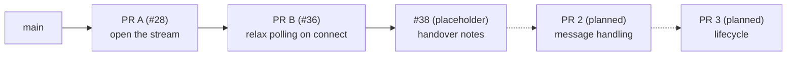

# SSE change notifications: handover

> **Placeholder.** This PR holds the next position in the SSE stack (after PR A #28 and PR B #36). It carries only these handover notes so that whoever picks up the work has the plan and the current state in one place. The next PR (message handling, "PR 2" below) will be built on this branch and will replace this placeholder, and these notes should be trimmed or removed when the work lands. Do not merge this PR on its own.

## Goal
The Go provider opens the SSE stream the CDN config advertises. A message is a doorbell: it says "the config changed, fetch it". It never carries flags. Behaviour should match the Java provider unless noted. Keep names searchable across languages (`RunSSE`, "SSE manager").

## Status
| Piece | Branch / PR | State |
|---|---|---|
| A: parse the stream from the CDN config, stream manager, start after first config, `WithSSEDisabled`, docs | `feat/sse-open-stream`, PR #28 | pushed, draft, CI green, no review yet |
| B: `Poller` (interval change, trigger), catch-up fetch and connected cadence on connect, docs | `feat/sse-connect-polling`, PR #36 | stacked on A (base `feat/sse-open-stream`), draft, CI green, no review yet |
| Handover notes (this PR) | `docs/sse-handover`, PR #38 | placeholder, draft, stacked on B (base `feat/sse-connect-polling`) |
| PR 2: message handling | not started | see below; build it on this branch |
| PR 3: lifecycle (disconnect, reconnect, grace) | not started | see below |

The same diagrams as copy-paste Mermaid are in [`sse-pr-diagrams.md`](sse-pr-diagrams.md). The overview:

e2e tags enabled today: A `@discovery`, B `@discovery,@connect`. Other `@sse` groups stay excluded in `e2e/cdn_test.go` until the PR that implements them.

## Decisions already made
- SSE read timeout 150 s, because that is more than twice the 60 s keep-alive. No connect or write timeout.
- The stack is merged together after review (stated on #36), not one PR at a time.
- Never log credentials or a raw stream URL: always `MaskURL`. Also scrub error strings (`net/http` puts the URL in `url.Error`) and the library logger.
- The stream URL comes from the CDN config (flat `url` wins, else `endpoint.requestUri` + `endpoint.origin`, falling back to the CDN origin). We do not derive the channel name.
- A stream that never connects keeps retrying (with jitter). It is not a disconnect: no cadence or state change.
- SSE start is idempotent and also runs on the first successful fetch, so a provider that started in ERROR still opens SSE later.
- Library: `launchdarkly/eventsource` v1.9.1. It has no open/close callbacks, so reconnects need a `RoundTripper` wrapper (PR 3). A stdlib client is an open option; it is cheaper to decide before PR 3.
- Provider state follows CDN fetch outcomes only. SSE connect/disconnect only pick the poll cadence.

## Behaviour rules for PR 2 and PR 3
- Only `refetchConfig` acts. Unknown or missing `type`, unparseable and empty messages are dropped, the stream stays open. Accept flat and envelope (`data` string) shapes.
- Ordering: drop a message whose `lastModified` is older than what is applied (PR 2, not done). Rejecting a 200 whose `Last-Modified` is not newer than the stored one (treated as 304) already exists in `internal/fetch.go`.
- Cadence: SSE connected 10 min, disconnected or disabled 10 s. Switching re-anchors the ticker.
- Single flight: one CDN fetch at a time. A colliding poll tick is skipped. A colliding SSE re-fetch is deferred and coalesced (keep the greatest `lastModified`). The reconnect catch-up is never dropped.
- Any failed fetch: READY -> STALE and arms the grace timer; grace expiry -> ERROR; a successful fetch -> READY. Never FATAL.
- Shutdown: close stream, cancel timers, abort in-flight requests, NOT_READY, idempotent.
- PR 2 also needs `emitSSE` and the `@shutdown` steps (scenario "Shutdown closes the SSE stream" in `sse.feature`). They exist as commit `4c7b171` on `feat/sse-discovery-connect` (cherry-pick it; it was written before the harness v1.3.0 and `main` changes, so expect conflicts in `e2e/`).
- PR 2 also owns the `@single-flight` scenario ("A poll tick that finds a fetch in flight is skipped", `gherkin/cdn.feature`). Its pending step `an SSE re-fetch is triggered shortly before the next poll tick` is in `e2e/cdn_test.go`. Implement it with `emitSSE` and drop `~@single-flight` from `Tags`.
- The provider already has the state loop on `main`: a failed fetch goes READY -> STALE, emits `PROVIDER_STALE` and arms a grace timer (default 60 s, field `gracePeriod`, no exported option yet). PR 3 still needs: an exported grace option wired to `GRACE_PERIOD_MS` in `gherkin/timings.json`, the disconnect cadence switch (10 s), reconnect detection, and a check that grace expiry gives ERROR and a later success gives READY. The connected interval from `timings.json` is already done in PR B (`WithSSEConnectedPollInterval`).
- The PR 3 `@grace` scenario triggers its failing fetch with an emitted `refetchConfig`, so it needs `emitSSE` from PR 2.

## Open questions
- Does the production CDN ETag cover `eventStreams`? Until verified, `ParseSSEURL` runs on every config instead of skipping when the ETag is unchanged.
- Stdlib SSE client or keep the library?
- Java provider leaks stream credentials in two places (start-failure warning via `URI.create`, and the library debug log). To raise with the Java owners.
- Merge strategy: the stack merges together, but squash versus merge commit is still unchecked. If the repo squashes, per-commit types never reach the changelog.

## How to work here
- Commits: one short line, Conventional Commits (`feat:`, `fix:`, `chore:`), no body. `lint-pr.yml` enforces PR titles. CHANGELOG is release-please managed: do not edit.
- Comments: Go doc style (start with the name), short, one "because ...".
- Tests: crucial paths only (connect, retry, shutdown, credential masking, discovery, disable, recovery after failed init). Prefer one table over near-duplicate tests.
- Before pushing: `gofmt -l .` (ignore `fm-provider-test-harness/`), `go vet ./...`, `go test -race -count=1 ./...`, `golangci-lint run`. `-race` needs a C compiler on PATH. `golangci-lint` does not check formatting.
- `e2e/` is a separate Go module. `fm-provider-test-harness/` is a submodule: do not edit it. Bump with a PR from `origin/main`.
- e2e needs a container runtime: `git submodule update --init fm-provider-test-harness`, then `cd e2e; go test -count=1 -timeout 20m ./...`. With Podman on Windows: set `DOCKER_HOST` to the machine pipe (`podman machine inspect --format '{{.ConnectionInfo.PodmanPipe.Path}}'`) and `TESTCONTAINERS_RYUK_DISABLED=true`. A full run takes about 260 s. One scenario: `-run 'TestCDNE2E/<Scenario_name_with_underscores>'`.
- Time-based scenarios run in real time. A laptop sleep can wedge a run: rerun.
- The repo uses LF line endings.
