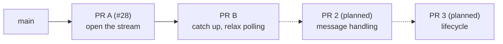
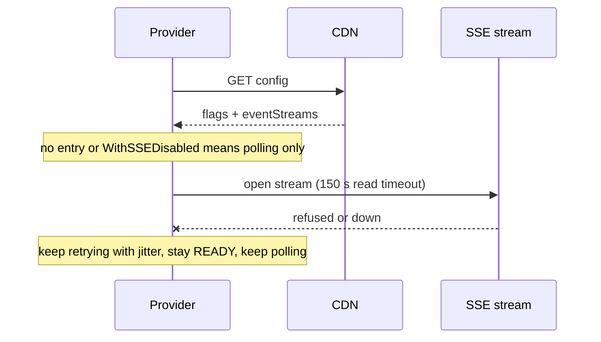
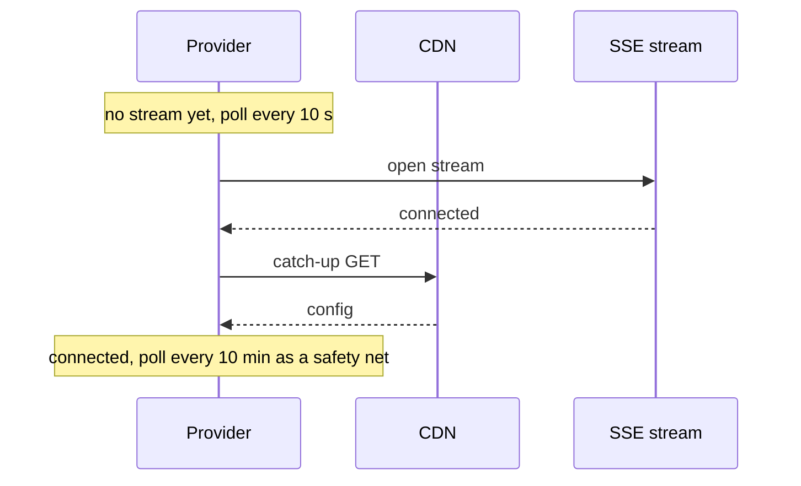
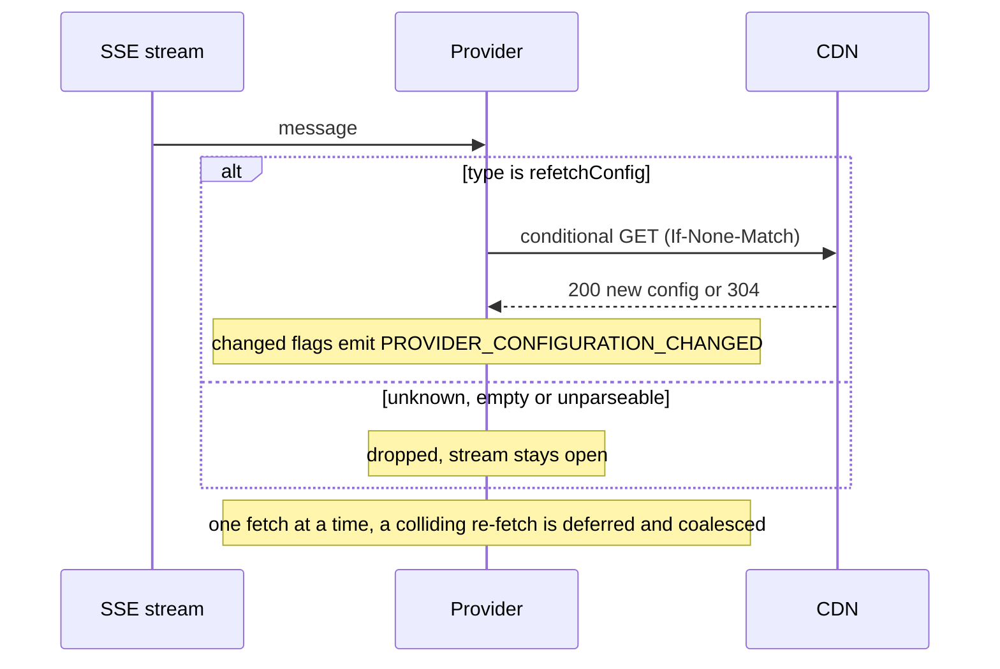
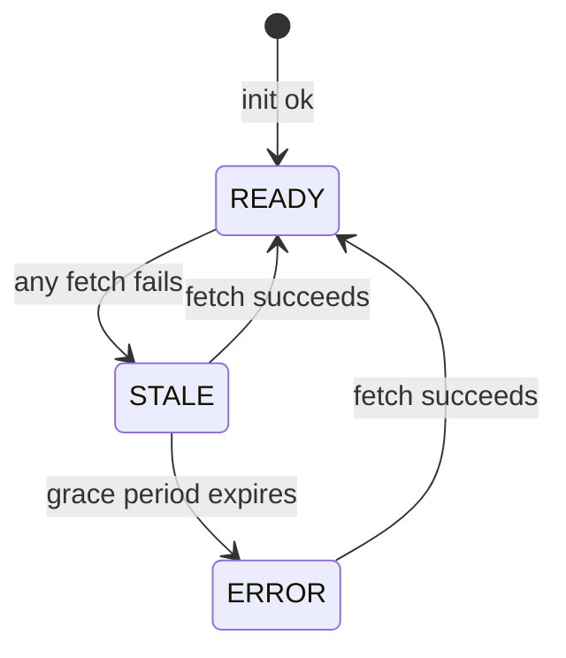
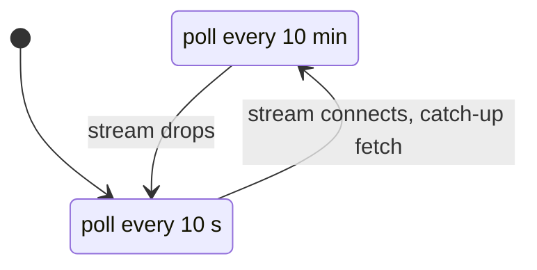

# SSE work: diagrams per PR

Placeholder notes, see [`sse-handover.md`](sse-handover.md). Mermaid, so it renders in GitHub, GitLab and most markdown viewers. PR A (#28) and PR B (#36) are written. PR 2 and PR 3 are planned.

## Overview

## PR A: open the advertised stream

## PR B: catch up and relax polling on connect

## PR 2 (planned): handle messages

## PR 3 (planned): lifecycle

Provider state follows CDN fetch results only.

The stream only picks the poll cadence. It never changes the state.

